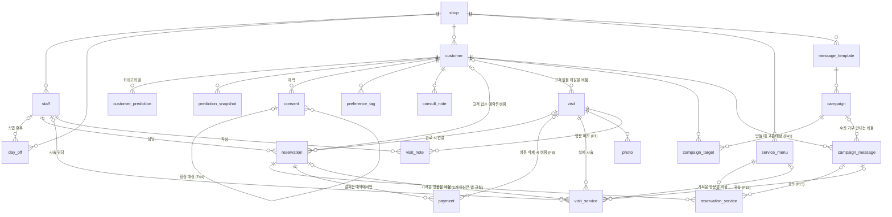

# 아키텍처

> 작성일: 2026-11-23 · 상태: 초안 · 기준 문서: [요구사항 명세서](../요구사항명세서.md), [기획서](../기획서.md) 11장, [결정 체크리스트](../결정체크리스트.md) (A14 기술 스택 포함)
> 이 문서는 확정된 요구사항을 구현 구조로 옮긴 파생 문서다. 요구사항을 새로 만들지 않고 ID로 가리킨다. 각 항목의 상태: **[확정]** 기준 문서에 근거 있음 (기준 문서가 스스로 "제안"으로 적은 것은 제외) · **[제안]** 일관된 설계 초안, 팀 확인 전 · **[검토 필요]** 정해야 하는데 근거 없음.

## 1. 전제 [확정]

| 전제 | 근거 |
| --- | --- |
| 애플리케이션 서버 하나(Spring Boot)와 MySQL 1대로 운영할 수 있는 구조로 만든다. 이번 프로젝트는 배포하지 않고, 로컬에서 프론트 개발 서버를 따로 띄워 실행한다 (3장) | NFR-14, A14 |
| 모의 데이터로 개발·시연한다. 실제 매장 운영(파일럿)은 하지 않지만 설계는 실제 운영을 전제로 한다 | 결정체크리스트 「프로젝트 범위」, 명세서 6장 「제약」 |
| 메시지는 서비스 내부 가상 발송기로만 처리하고 실제로 전송하지 않는다 | A6, FR-CMP-08 |
| 계정 하나에 매장 하나. 모든 업무 데이터는 `shop_id`로 매장 단위 격리 | 명세서 6장 「제약」, 5장, NFR-03 |
| 매장 PC 한 대를 스탭이 함께 쓴다. 매장 계정 로그인 → 근무자 PIN → 잠긴 기능 PIN 재입력 | A3, D6, 명세서 2장 |
| 모든 날짜 계산·야간 제한은 Asia/Seoul 기준 | NFR-12 |

## 2. 기술 스택

| 영역 | 내용 | 상태 | 근거 |
| --- | --- | --- | --- |
| Backend | Java 21 · Gradle · Spring Boot (Spring MVC, Bean Validation) | [확정] | A14 |
| Spring Boot 버전 | 4.2.0. 골격을 만들 때 Spring Initializr 안정판으로 정함 (이전 프로젝트 그래빗은 4.1.2) | [확정] 개발 저장소 골격 (2026-11-23) | A14 |
| 인증·권한 | Spring Security 매장 계정 세션 로그인 + 근무자 PIN + 잠긴 기능 PIN 재인증. 세션 쿠키 HttpOnly·Secure·SameSite, CSRF 보호, BCrypt 해시 | [확정] | 명세서 2장, NFR-02·04, A14 |
| 데이터 | MySQL 8 + Spring Data JPA | [확정] | A14 |
| 스키마 관리 | Flyway (`ddl-auto`로 테이블을 만들지 않음) | [확정] Flyway / [제안] `ddl-auto` 금지 | A14 |
| Frontend | React + Next.js (TypeScript) | [확정] | A14 |
| Frontend 빌드 방식 | Next.js 정적 빌드(`output: 'export'`). 로컬에서는 Next.js 개발 서버를 따로 띄움 (3장) | [확정] | A14 추가 결정 |
| 3D | three.js 사용 가능. 요구사항에 3D 화면은 없음 | [확정] (선택 사용) | A14 |
| 관리자 화면 다국어 | i18next + react-i18next 클라이언트 i18n. 정적 빌드 · App Router 구조는 그대로이고, 언어는 브라우저 `localStorage`에 둔다. 서버 응답 · 검증 메시지는 바꾸지 않는다 | [확정] 방식 (F75) / 구현 전 | FR-I18N-02 |
| 그 밖의 프론트 라이브러리 | 필요할 때 추가 (후보는 `docs/DEVELOPMENT.md` 「4」) | [확정] 방침 | A14 |
| 예약 발송·결과 갱신 | Spring `@Scheduled` (별도 큐 없음) | [제안] | 기획서 11장, 명세서 6장 「가정」 |
| 사진 저장 | 서버 로컬 비공개 디렉터리 + HMAC 서명 URL(만료 5분). 저장소 접근은 컴포넌트 하나 뒤에 두어 운영 시 S3 호환으로 교체 | [확정] 2026-11-23 변경 | 명세서 6장 「외부 연동」, NFR-07, F16 |
| 전송 | 전 구간 HTTPS | [확정] | NFR-05 |
| 로컬·테스트 DB | Docker Compose로 띄운 MySQL 8 (그래빗과 같은 방식). CI는 MySQL 서비스 컨테이너 | [제안] | — |
| Node.js 버전 | 24 (`package.json` `engines`·`.nvmrc`로 고정, Keepsy #119) | [확정] 2026-11-23 | — |
| Next.js · React 버전 | Next.js 16.4.6 (App Router, Turbopack) · React 19.3.1 · TypeScript 5.9.3. 전환할 때 npm 안정판으로 정함. App Router는 React 19가 필요하다 | [확정] 개발 저장소 프론트 전환 (2026-11-24, Keepsy #119) | A14 |
| 백엔드 포매터 | Spotless + google-java-format AOSP 스타일(4칸). `spotlessCheck`는 Gradle `check`에 포함되어 CI `./gradlew build`에서 함께 돈다 | [확정] | 결정체크리스트 F18 |
| 실행 환경 | 배포하지 않고 로컬에서 실행·시연. HTTPS(NFR-05)·백업(NFR-10)은 실제 운영을 전제로 한 설계로만 둠 | [확정] | A14 추가 결정 |

## 3. 시스템 구성

구성도는 [기획서](../기획서.md) 11장 「기술 스택과 시스템 구성」의 mermaid 그림이 기준이다. 요약하면:

- 브라우저는 앱과만 통신한다 (HTTPS + 세션 쿠키). DB·사진 저장소·(나중의) 문자 API는 앱을 통해서만 접근한다.
- 앱 안에 Spring Security(로그인·PIN·CSRF·API 권한 검사), Controller(REST API + 정적 화면), Service + JPA(예측·캠페인·성과 귀속), Scheduler(예약 발송·결과 갱신), 가상 발송기가 있다.
- API 키·DB 비밀번호는 서버 환경 변수에만 둔다 (NFR-09).

### 저장소 구성 [제안]

개발 저장소 하나에 백엔드와 프론트를 함께 둔다. 실행은 따로 하지만, 화면과 API 계약을 한 PR에서 같이 바꿀 수 있다.

```text
backend/        Spring Boot (Gradle). 패키지는 4장
frontend/       Next.js (TypeScript). 구조는 4장
compose.yaml    로컬 MySQL 8.4: 개발 mysql(3306) · 테스트 mysql-test(3307, profile test) · 데모 mysql-demo(3308, profile demo)
.env.example    환경 변수 이름과 설명 (docs/DEVELOPMENT.md 「5」)
```

### 로컬 실행 [확정 A14 / 세부 제안]

배포하지 않고 로컬에서 프론트와 백엔드 서버를 따로 띄운다 (A14 추가 결정).

```text
브라우저 ── http://127.0.0.1:3000 ──▶ Next.js 개발 서버 (화면)
                                       │ /api/** 만 넘김 (rewrites)
                                       ▼
                                     Spring Boot 127.0.0.1:8080 (API) ──▶ MySQL 127.0.0.1:3306 (Docker Compose)

백엔드 테스트 ──▶ 테스트 DB 127.0.0.1:3307 (tmpfs)      시연 · seedDemo ──▶ 데모 DB 127.0.0.1:3308
```

- 백엔드 · MySQL · 프론트 개발 서버는 `127.0.0.1`에만 연다 (F64). 실행 명령과 순서는 `docs/DEVELOPMENT.md` 「6」.

- 브라우저는 3000번만 연다. `/api/**` 요청은 Next.js가 8080으로 넘기므로, 브라우저 입장에서는 같은 출처다. 세션 쿠키·CSRF가 그대로 동작하고 CORS 설정이 필요 없다.
- rewrites는 개발 모드에서만 켠다. 정적 빌드(`next build`)에는 rewrites가 들어가지 않기 때문이다.
- 로컬은 http라 세션 쿠키의 Secure를 끈다 (`docs/DEVELOPMENT.md` 「5」). HTTPS(NFR-05)는 실제 운영 때의 설계로 남긴다.

### 서버 하나로 띄우기 (필요할 때만) [제안]

정적 빌드를 쓰므로, 시연을 프로세스 하나로 하고 싶으면 합칠 수 있다. 지금은 하지 않는다.

| 단계 | 하는 일 |
| --- | --- |
| 프론트 빌드 | `next build`가 정적 파일을 `frontend/out/`에 만든다 |
| 합치기 | `frontend/out/`을 백엔드 정적 자원 위치(`static/`)로 복사해 jar에 넣는다 |
| 제공 | Spring Boot가 `/api/**`는 Controller로, 나머지는 정적 파일로 응답한다. Next.js는 `/customers` 화면을 `customers.html`로 만들므로 확장자 없는 경로를 `.html`로 찾아 주는 설정이 필요하다 |

### 정적 빌드의 제약 [확정 A14]

로컬에서 개발 서버로 띄울 때도 똑같이 지킨다. 개발 서버에서는 동작해도 `next build`에서 실패하기 때문이다.

- Next.js 서버 기능(SSR, API Routes, Server Actions, 미들웨어)을 쓰지 않는다. 데이터는 모두 브라우저에서 `/api`로 가져온다.
- ID가 들어가는 화면은 동적 경로(`/customers/[id]`) 대신 쿼리로 연다: `/customers/detail?id=12`. 빌드할 때 고객 ID를 알 수 없기 때문이다.
- `next/image`의 이미지 최적화를 쓰지 않는다 (`images.unoptimized`). 시술 사진은 서명 URL을 그대로 쓴다 (NFR-07).

## 4. 모듈 구성 [제안]

### 백엔드 패키지

명세서 ID의 영역 코드를 그대로 패키지 경계로 쓴다. 이슈 라벨(`.github/labels.yml`)도 같은 코드를 쓴다.

| 패키지 (예) | 영역 코드 | 담는 것 |
| --- | --- | --- |
| `account` | ACC · SET 일부 | 매장 가입·로그인, 스탭, PIN 인증, 근무자 전환, 기능별 공용/PIN 설정. `shop` 테이블을 다루는 매장 정보·영업시간, 발송·보관 설정, 카테고리 기본 주기도 여기 둔다 (F21) |
| `customer` | CUS | 고객, 동의 이력, 취향 태그, 상담 메모, 사진, CSV 일괄 등록, 삭제(파기) |
| `reservation` | RSV | 예약, 예정 시술, 예약 가능 시간 계산, 캘린더 |
| `visit` | VIS · PAY | 방문, 실제 시술, 결제, 시술 마감 카드 |
| `prediction` | PRD | 다음 방문 기간 계산, 상태 분류, 우선순위, 처리 표시, 예측 스냅샷 |
| `campaign` | CMP | 템플릿, 캠페인, 대상 선정·제외, 대조군, 발송, 가상 발송기·가상 휴대폰, 수신 거부 |
| `analytics` | ANL | 전환 퍼널, 귀속 계산, 연결 매출, 매장 기본 지표, 예측 정확도, 대조군 비교 |
| `dashboard` | DSH | 대시보드 조회 조합 |
| `search` | SCH | 고객 통합 검색, 미매칭 검색어 (기능 키워드 사전은 프론트 정적 파일). 두 API는 남아 있으나 화면은 부르지 않는다 (FR-SCH-04 · 06 범위 제외, F74) |
| `settings` | SET | 시술 메뉴, 휴무일 (`shop` 테이블 칸은 `account`, F21) |
| `common` | NFR | 보안 설정, 권한 검사, 오류 응답, 접근 로그, 시간대, 정적 화면 경로 설정 (3장 「서버 하나로 띄우기」를 할 때만, 지금은 없음) |

- 계층은 Controller → Service → Repository (`docs/DEVELOPMENT.md` 「4」).
- 패키지 사이는 ID 참조와 Port로만 연결하고, 화면용 도메인 횡단 조회는 조회 전용 Repository에서 DTO Projection으로 한다 (`docs/DEVELOPMENT.md` 「4」 「도메인 연동」, 2026-11-23 팀 결정).
- 외부 호출 없이 값만으로 결과가 정해지는 규칙은 Service에서 떼어 단위 테스트한다: 예측 계산(FR-PRD-01), 상태 분류(FR-PRD-04), 우선순위(FR-PRD-09), 귀속(FR-ANL-03·FR-VIS-04), 예약 가능 시간(FR-RSV-04), 광고 문구 삽입·바이트 계산(FR-CMP-04·05), 야간 제한(FR-CMP-07).
- `PAY`를 `visit`에 둔 이유: 결제·방문 생성·예약 완료가 시술 마감 카드 저장 한 번으로 함께 처리된다 (FR-PAY-04, FR-VIS-01). 패키지를 나누면 한 트랜잭션이 두 패키지에 걸친다.

### 프론트 구조

```text
frontend/
  src/app/                 화면 경로별 page.tsx (아래 표)
  src/app/(shop)/layout.tsx  매장 화면 공통 셸(사이드바 · 상단바). 그룹 이름은 URL에 들어가지 않음 (Keepsy #393)
  src/app/not-found.tsx    없는 주소 화면 (정적 빌드에서 404.html, Keepsy #406)
  src/app/(shop)/error.tsx   매장 화면 본문 오류. 셸(사이드바 · 상단바)은 남기고 본문만 바꾼다 (Keepsy #407)
  src/app/error.tsx        셸 밖 화면(소개 · 로그인 · 가입 등) 오류 (Keepsy #407)
  src/app/global-error.tsx  루트 layout까지 실패했을 때. `<html>` · `<body>`를 직접 그린다 (Keepsy #407)
  src/components/          공용 UI: 레이아웃, PIN 입력 창, 표, 페이지 이동
  src/features/<영역>/      영역별 화면 조각과 API 호출 (대체로 백엔드 패키지 이름, 랜딩은 landing)
  src/hooks/useLoad.ts     「처음 불러오기 + 다시 불러오기」, 마지막 요청의 응답만 반영 (src/lib/latest.ts, Keepsy #344)
  src/lib/api.ts           fetch 래퍼: CSRF 헤더, 오류 code 처리
  src/lib/*.ts             화면 계산 규칙. 옆의 *.test.ts를 `npm test`(node --test)로 검사
  src/lib/i18n.ts          화면 언어: t() · 언어 저장 · 오류 code 번역 (F74, Keepsy #451)
  src/lib/messages/<언어>.ts  화면 문구 사전. ko.ts가 원본(키 타입), en.ts는 키를 모두 채워야 typecheck 통과
  src/components/common/LocaleRoot.tsx  저장된 언어 적용(hydration 뒤 한 번 다시 마운트) · <html lang>
  public/search-keywords.json   기능 검색 키워드·동의어 사전 (FR-SCH-02 "정적 파일")
```

**매장 화면(`(shop)` 그룹)에 공통**: 셸이 없는 화면은 랜딩(`/`) · 로그인 · 가입 · 근무자 전환 · 비밀번호 재설정 · 가상 메일함 · 동의 태블릿 · 디자인 시스템이다. 좌측 메뉴 7개(기획서 8장), 상단 검색창(`/`·`Ctrl+K`, FR-SCH-01), 현재 근무자 이름을 크게 표시(FR-ACC-10), PIN 인증 중이면 인증 스탭 이름과 [잠금] 버튼(FR-ACC-08).

**API 호출 규칙** (`src/lib/api.ts` 한곳에서 처리):

| 응답 code (`docs/CONTRACTS.md` 「2」) | 화면 동작 |
| --- | --- |
| `unauthorized` | `/login`으로 이동 |
| `worker_required` | `/shift`(근무자 PIN)로 이동 |
| `pin_required` | PIN 입력 창 → 인증되면 같은 요청을 다시 보냄 |
| `owner_pin_required` | 원장 PIN 입력 창 (`message`를 함께 표시, 예: 예약 제한 사유) |
| `csrf_invalid` | 토큰 쿠키를 다시 읽어 한 번만 다시 보냄 |
| 그 밖의 code · 네트워크 실패(`network_error`) · 읽을 수 없는 응답(`invalid_response`) | `message`를 그대로 보여 줌. 화면이 오류를 직접 보여 줄 때는 `silent` 옵션으로 끔. 한국어가 아닌 화면에서는 `ApiError`가 만들어질 때 `message`가 code별 안내로 바뀐다(아래 「화면 문구 · 언어」) |

- 연락처 마스킹은 서버가 한다 (NFR-04). 화면에서 다시 가리거나 풀지 않는다.
- 날짜·시각은 Asia/Seoul로 표시한다 (NFR-12).

**화면 문구 · 언어** (FR-I18N-02, 결정 F74):

- 화면 문구는 코드에 한글로 직접 쓰지 않고 `t('영역.이름', { 변수 })`로 쓴다. 키는 `src/lib/messages/ko.ts`에 먼저 넣고 같은 PR에서 `en.ts`도 채운다(빠지면 typecheck 실패). `t()`는 훅이 아닌 일반 함수라 `src/lib/*.ts`의 순수 함수에서도 쓴다.
- 기존 화면의 한글 문구는 기능 폴더(`src/features/<영역>/` + 그 영역의 `src/lib/*.ts`) 단위 PR로 옮긴다. 시점은 프론트 담당과 맞춘다 (F74 ④). 새로 쓰는 화면은 처음부터 `t()`를 쓴다.
- 언어는 브라우저별 `localStorage`(`keepsy.locale`)에 저장하고 기본은 한국어다. 정적 빌드의 HTML은 한국어이므로 `LocaleRoot`가 hydration 뒤 저장된 언어를 적용하고 앱을 한 번 다시 마운트한다. 언어를 바꾸면 새로고침한다.
- 날짜 · 숫자 서식은 `'ko-KR'`을 직접 쓰지 않고 `intlLocale()`을 쓴다. 금액은 `formatWon`.
- 서버 오류 문구는 화면이 오류 `code`로 번역한다(`messages/en.ts`의 오류 안내). 서버 `message` · 칸별 사유(`details`)는 한국어 그대로다 (F74 ③).
- 매장이 입력한 값(시술 메뉴명 · 고객명 등)과 캠페인 · 자동 안내 문자는 번역하지 않는다. 기능 검색 키워드 사전(`public/search-keywords.json`)의 영어 버전은 기능 검색(SCH) 문구를 옮길 때 정한다.

### 화면 경로

메뉴와 화면은 기획서 8장을 따른다. "기능 키"는 그 화면의 기본 권한이고, 한 화면 안의 다른 영역은 그 영역의 기능 키를 따른다 (6장).

| 경로 | 화면 | 기능 키 | 요구사항 |
| --- | --- | --- | --- |
| `/` | 로그인 전 소개(랜딩) (Keepsy #392) | 비로그인 | — |
| `/signup` | 매장 가입 | 비로그인 | FR-ACC-01 |
| `/login` | 매장 로그인 | 비로그인 | FR-ACC-02 |
| `/password-reset` | 비밀번호 재설정 (P2) | 비로그인 | FR-ACC-06 |
| `/virtual-mailbox` | 가상 메일함 (개발 · 시연용, F59) | 비로그인 | FR-ACC-06 |
| `/shift` | 근무자 PIN 입력·전환 | 매장 세션 | FR-ACC-10 |
| `/dashboard` | CRM 대시보드 | `DASHBOARD_SEARCH` (영역별 `INSIGHT`·`CAMPAIGN_VIEW`) | FR-DSH-01~06 |
| `/reservations` | 스탭별 주간 캘린더, 예약 등록·수정 (`?view=day` 일간 보기 P2) | `RESERVATION` | FR-RSV-01~05 |
| `/reservations/detail?id=` | 예약 상세, 고객 없는 예약의 [고객 연결] | `RESERVATION` | FR-DSH-01, FR-RSV-03 |
| `/reservations/closing?id=` | 시술 마감 카드 | `RESERVATION` | FR-PAY-04, FR-VIS-05 |
| `/customers` | 고객 목록·검색 | `CUSTOMER_VIEW` | FR-CUS-02 |
| `/customers/new` | 고객 등록 | `CUSTOMER_WRITE` | FR-CUS-01 |
| `/customers/detail?id=` | 고객 상세·시술 히스토리북 | `CUSTOMER_VIEW` (영역별) | FR-CUS-03~11, FR-PRD-02 |
| `/customers/import` | CSV 일괄 등록 (P2) | `CUSTOMER_WRITE` | FR-CUS-13 |
| `/customers/retention` | 파기 대상 목록 | `OWNER_PIN` | FR-CUS-12 |
| `/consent?customerId=` | 태블릿 본인 체크 (고객이 직접 체크) | `CONSENT` | FR-CUS-09 |
| `/insights` | 재방문 관리 (상태별 탭) | `INSIGHT` | FR-PRD-05~07 |
| `/campaigns` | 캠페인 목록 | `CAMPAIGN_VIEW` | FR-CMP-10 |
| `/campaigns/new` | 캠페인 작성 (대상 → 템플릿 → 미리보기 → 검토 → 발송) | `CAMPAIGN_SEND` | FR-CMP-01~09·12·18 |
| `/campaigns/detail?id=` | 캠페인 결과·퍼널·대조군 비교 | `CAMPAIGN_VIEW` | FR-ANL-01·04·09 |
| `/campaigns/templates` | 템플릿 관리 | `CAMPAIGN_SEND` | FR-CMP-03 |
| `/campaigns/reconfirm` | 동의 재확인 대상 | `CAMPAIGN_VIEW` | FR-CMP-13 |
| `/virtual-phone` | 가상 휴대폰 | `CAMPAIGN_SEND` | FR-CMP-11·16 |
| `/analytics` | 성과 분석 (캠페인 전환 퍼널·연결 매출·대조군 비교, 매출·주기 내 재방문율·예측 정확도) | `SALES_ANALYTICS` (영역별 `CAMPAIGN_VIEW`) | FR-ANL-01·02·05~07·09 |
| `/settings` | 매장 설정 (탭: 매장 정보·영업시간, 시술 메뉴, 휴무일, 예측 기준, 발송, 보관 기간, 스탭·PIN·기능 잠금) | `OWNER_PIN` (원장 PIN 재설정 FR-ACC-09는 원장 PIN 없이 매장 계정 비밀번호로, `docs/CONTRACTS.md` 「4」 `PUT /api/owner-pin`) | FR-SET-01~07, FR-ACC-03~05·09 |
| `/design-system` | 디자인 시스템 (개발용. 메뉴에 없음, 나중에 쓸 수 있어 유지, 2026-11-23 결정) | — | — |

## 5. 데이터

**기준은 명세서 5장 「데이터 요구사항」이다.** 엔티티·속성·고유 제약은 5장을 따르고, 이 절은 관계와 구현 메모만 더한다.

### 관계도 (5장에서 파생)



주요 관계만 그렸다. `shop`과의 관계는 모든 업무 테이블에 있고(5장), 작성·처리 스탭(상담 메모, 동의, 캠페인 검토자)과 `payment.customer_id`, `access_log`·`search_miss_log`, 매장만 참조하는 `password_reset_token`·`virtual_mail`은 생략했다. 그림의 관계는 DB 외래 키 기준이다. 서로 다른 패키지(4장) 사이의 관계는 JPA에서 객체로 매핑하지 않고 ID로 참조한다 (`docs/DEVELOPMENT.md` 「4」 「도메인 연동」).

### 구현 메모

| 항목 | 내용 | 상태 |
| --- | --- | --- |
| 매장 격리 | 모든 업무 테이블에 `shop_id`. 모든 조회 조건에 세션의 `shop_id` | [확정] 5장, NFR-03 |
| 고유 제약 | (shop_id, 휴대폰), (customer_id, 카테고리), (customer_id, 방문일), 매장 안 PIN 중복 불가 등은 5장 비고대로 | [확정] 5장 |
| NULL과 고유 제약 | 5장은 "삭제된 고객의 휴대폰 NULL", "고객 없는 방문"을 고유 제약에서 빼라고 한다. MySQL 고유 인덱스는 NULL을 서로 다른 값으로 보므로 별도 처리 없이 만족된다 | [제안] |
| PIN 중복 검사 | PIN은 해시라 DB 고유 제약을 걸 수 없다. 등록·재설정 때 서버가 같은 매장 스탭의 해시와 하나씩 비교한다 | [확정] 5장 staff 비고 |
| 귀속 발송 ID | `reservation_service`·`visit_service`의 "귀속 발송 ID"는 고객별 발송 기록인 `campaign_message.id`를 가리킨다. 외래 키는 V5에서 추가 (아래 migration 버전 번호) | [확정] F15 |
| 기본키 | `BIGINT` 자동 증가 | [제안] |
| enum 저장 | 문자열로 저장 (`@Enumerated(EnumType.STRING)`). 값 목록은 `docs/CONTRACTS.md` 「3」 | [제안] |
| 시각 저장 | DB·JVM·JDBC 시간대를 Asia/Seoul로 고정하고 `DATETIME`·`DATE`로 저장 | [제안] NFR-12에서 파생 |
| 로그인·PIN 실패 잠금 상태 | 실패 횟수·잠금 해제 시각을 `shop`에 둔다 (서버 재시작 뒤에도 유지). 로그인·원장 PIN 재설정의 비밀번호 재확인·PIN 입력은 매장 행을 `SELECT … FOR UPDATE`로 잠근 한 트랜잭션에서 잠금 확인 → 검증 → 횟수 갱신을 한다 (F11·F14). 비밀번호 재설정 토큰은 `password_reset_token` 표에 해시로 두고, 사용은 `사용 시각 IS NULL AND 만료 시각 > now` 조건부 UPDATE로 한 번만 성공시킨다 | [확정] F14 |
| 스키마 관리 | Flyway migration 파일(`V{n}__{설명}.sql`)로 관리한다. 이미 적용된 파일은 고치지 않고 새 버전을 더한다. `ddl-auto`로 테이블을 만들지 않는다 | [확정] Flyway (A14) / [제안] 운영 규칙 |
| migration 버전 번호 | 여러 사람이 동시에 만들어 번호가 겹치지 않도록 첫 스키마는 이슈별로 미리 정한다: V1 매장·스탭·휴무일·시술 메뉴(Keepsy #6), V2 고객·동의·취향 태그·상담 메모(#7), V3 예약·방문·시술 항목·결제·사진(#8), V4 예측·예측 스냅샷(#9), V5 템플릿·캠페인·캠페인 메시지(#10), V6 접근 로그·미매칭 검색어 로그(#11). 그 뒤 migration은 V7부터 `main`에 머지되는 순서로 번호를 붙이고, 머지 전에 `main`의 마지막 번호를 확인해 겹치면 올린다. 뒤 번호 테이블을 가리키는 외래 키(예: V3 `reservation_service`·`visit_service`의 귀속 발송 ID → V5 `campaign_message`)는 뒤 번호 파일에서 `ALTER TABLE`로 추가한다. 첫 스키마 PR은 V1→V6 순서로 머지한다. 순서가 어긋나 로컬 DB에서 Flyway 검증이 실패하면 그 로컬 개발 DB를 다시 만든다(로컬 데이터 삭제). 볼륨을 모두 지우는 `docker compose down -v`는 데모 DB까지 지우므로 쓰지 않는다. 방법은 다음 행과 `docs/DEVELOPMENT.md` 「6」 | 2026-11-23 팀 결정 |
| V7 이후 migration | V7 `campaign_target`(F41), V8 `consent.corrects_consent_id`(F44), V9 `campaign_message.send_after`(F48), V10 `password_reset_token` · `virtual_mail`(F14 · F49), V11 `prediction_snapshot.churn_signal_days`(F57), V12 인덱스 2개(8장), V13 `shop.industries`(켜 둔 업종을 쉼표로 이은 문자열, 기본값 5개 모두라 기존 매장은 모두 켜짐, F72). 개발 · 데모 DB 볼륨이 따로 있으므로(3장) `down -v`처럼 볼륨을 모두 지우는 명령은 데모 데이터도 지운다. 지울 볼륨을 확인하고 필요한 것만 지운다 (`docs/DEVELOPMENT.md` 「6」) | 구현: Keepsy main (V1~V13) |
| 잠금 순서 | 업무별로 코드에서 확인한 잠금 획득 순서. 교착이 없다는 증명은 아니고, 잠금 대기 시간 초과 · 교착은 `conflict` 409로 응답하고 서버가 다시 시도하지 않는다 (F63). ① 시술 마감: 고객 → 예약 → 방문. 고객 ID를 잠그기 전에 따로 읽고, 잠근 뒤 다시 비교해 다르면 `conflict`(그사이 고객이 연결되면 잠근 고객과 실제 고객이 달라지는 것을 막는 정합성 검사) (Keepsy #336) ② 방문 수정 · 삭제: 고객 → 방문, 삭제는 그 뒤 예약. 같은 재비교 (#337) ③ 완료 예약에 메모 추가: 고객을 잠그고 삭제 여부 확인 (F61) ④ 고객 삭제: 고객 → 그 고객의 예약 · 예측 · 발송 기록 · 방문 메모 정리 ⑤ 예약 생성: 스탭 `FOR UPDATE` → (고객이 있으면) 고객 `FOR SHARE` ⑥ 예약 수정: 스탭 `FOR UPDATE` → 예약 `FOR UPDATE` (고객은 바꾸지 않아 다시 읽지 않음) ⑦ 고객 연결: 예약 `FOR UPDATE` → 고객 `FOR SHARE` ⑧ 그 밖: 매장 행(로그인 · PIN · 설정 · 발송 한도, F14 · F7), 템플릿 행(F43), 스탭 비활성화(F34). ①②⑤⑥은 잠금을 트랜잭션의 첫 일반 조회보다 먼저 건다(REPEATABLE READ는 첫 일반 조회에서 스냅샷을 잡기 때문) | [제안] 구현: Keepsy #336 · #337 / [확정] F63 |
| `customer.last_visit_date` | 컬럼은 있지만 갱신하지 않는다. 보관 기간(FR-CUS-12) 등 마지막 방문일은 방문 표에서 계산한다 (`RetentionExpiredQuery`). V2 컬럼 주석(「방문이 바뀔 때 갱신」)은 적용된 migration이라 고치지 않는다 | 구현: Keepsy main |

## 6. 인증·권한 구현 [제안]

**정책의 기준은 명세서 2장(기능별 공용/PIN 표)과 FR-ACC-01~10이다.** 이 절은 그 정책을 서버에서 어떻게 검사할지에 대한 제안이다.

### 세션에 두는 값

| 값 | 생기는 때 | 없어지는 때 | 근거 |
| --- | --- | --- | --- |
| 매장 (`shopId`) | 매장 계정 로그인 | 로그아웃, 세션 만료 | FR-ACC-02 |
| 현재 근무자 (`currentStaffId`) | 근무자 PIN 입력 | 근무자 전환, 로그아웃 | FR-ACC-10 |
| PIN 인증 스탭·만료 시각 (`pinStaffId`, `pinExpiresAt`) | 잠긴 기능 PIN 입력 ("잠긴 기능 사용 허용" 스탭만) | 5분 무입력, [잠금], 로그아웃 | FR-ACC-08, C23 |

현재 근무자와 PIN 인증 스탭은 다를 수 있다 (예: 원장이 와서 PIN 입력, D6).

### 검사 순서

1. 매장 세션이 없으면 거부 (401).
2. 현재 근무자가 없으면 거부. 로그인 직후 근무자 PIN 화면만 열린다 (FR-ACC-10).
3. 요청한 기능의 설정을 매장 설정(`shop`의 PIN 잠금 기능 목록)에서 읽는다.
   - **공용**: 통과.
   - **PIN**: PIN 인증이 유효하면 통과하고 만료 시각을 5분 연장한다. 아니면 거부.
   - **원장 PIN**: PIN 인증 스탭이 원장 스탭이면 통과. 아니면 거부.
4. 대상 데이터가 세션 매장 것이 아니거나 없으면 404 (NFR-03).
5. 연락처는 "고객 연락처 전체 보기"를 통과하지 못하면 응답에서 마스킹 (`010-****-1234`, NFR-04).

오류 code는 `docs/CONTRACTS.md` 「2」, 기능 키 목록은 같은 문서 「3」을 따른다.

### 한 화면에 여러 기능이 섞일 때

명세서 2장은 "각 영역은 그 정보가 속한 기능의 설정을 따른다"고 정했다. 고객 상세처럼 영역이 섞인 화면은 **영역마다 API를 나눠** 각 API가 자기 기능으로 검사하게 한다. 예: 고객 상세 기본 정보(고객 조회), 카테고리별 예측(인사이트), 수신 이력·캠페인 연결 기록(캠페인 목록·결과 조회), 결제 금액(매출·성과 분석 조회). 화면은 잠긴 영역의 응답을 받으면 가려 두고 PIN 입력 뒤 다시 요청한다.

### 시술 마감 카드 [결정 F9]

한 화면이지만 영역별 API로 나눠 각자 기능 키로 검사한다. 화면은 아래 순서로 부른다.

| 순서 | API | 기능 키 | 저장 단위 |
| --- | --- | --- | --- |
| 1 | (고객 없는 예약이면) 고객 연결 · 신규 등록 | `RESERVATION` · `CUSTOMER_WRITE` | 각자 트랜잭션 |
| 2 | 동의 받기 `POST /api/customers/{customerId}/consents` (사진 동의를 받으면 사진보다 먼저) | `CONSENT` | 각자 트랜잭션 |
| 3 | 마감 저장 `POST /api/reservations/{reservationId}/closing` | `RESERVATION` | 결제 · 방문 · 시술 · 방문 메모 · 예약 완료 · 귀속을 **한 트랜잭션** |
| 4 | 사진 `POST /api/visits/{visitId}/photos` (3의 응답의 방문 ID) | `CUSTOMER_WRITE` | 사진마다 |

- 3이 실패하면 아무것도 남지 않는다. 2에서 받은 동의는 실제 동의라 유지한다.
- 4가 실패해도 3은 유지된다. 완료된 예약의 마감 카드(FR-PAY-04)에서 사진만 다시 올린다. 잠긴 기능이면 `pin_required` → PIN 입력 → 같은 요청을 다시 보낸다 (4장 API 호출 규칙).
- 사진 저장소는 DB 트랜잭션 밖이다. 올릴 때는 저장소에 먼저 쓰고(키는 무작위) DB 행을 만든다. DB가 실패하면 저장소 객체를 지운다(실패하면 기록만 남김). 지울 때는 DB 행을 먼저 지우고 커밋 뒤에 저장소 객체를 지운다. 고아 객체가 생겨도 URL은 DB 행으로만 발급되므로 노출되지 않는다.

### 방문 삭제 = 마감 되돌리기 [결정 F8]

`DELETE /api/visits/{visitId}` 한 트랜잭션에서 고객 행 잠금(고객 있는 방문) → 방문 행 잠금(없으면 404) → 연결된 예약 모두 `CONFIRMED`·`visit_id` 비움 → 결제 취소 표시·`visit_id` 비움 → 시술·방문 메모·사진 행과 방문 삭제 → 예측 재계산(기준 방문일이 앞당겨지면 예측 스냅샷은 F62). 사진 파일은 커밋 뒤 삭제. 고객 없는 방문은 `conflict`, CSV로 가져온 방문은 방문만 삭제. 결제가 있으면 `CUSTOMER_EDIT`과 `PAYMENT_EDIT`을 모두 검사한다.

### 기록에 남는 사람

- 공용 기능의 작성자·처리자와 접근 로그: 현재 근무자 (FR-ACC-10).
- 잠긴 기능으로 한 일: PIN 인증 스탭 (명세서 5장 `access_log` 주요 속성 "PIN 인증 스탭 또는 현재 근무자").
- 예약·방문의 담당 스탭은 근무자와 별개로 고른다 (A3 「알아둘 점」).

## 7. 외부 연동 경계

외부 연동 목록과 우선순위는 명세서 6장 「외부 연동」이 기준이다.

| 경계 | 설계 | 상태 |
| --- | --- | --- |
| 메시지 발송 | 발송 처리 코드를 한곳에 모아, 실제 발송으로 바꿀 때 나머지 기능은 바꾸지 않는다 | [확정] 구조 조건 유지. 전환 자체(FR-CMP-17)는 이번 범위 밖 (명세서 7장 부록, F74) |
| | 발송은 컴포넌트 하나(예: `MessageSender`)를 거치고, MVP 구현은 가상 발송기다. 가상 발송기는 몇 초 뒤 결과를 바꾼다: 번호 형식 오류는 실패, 설정한 비율만큼 무작위 실패, 나머지는 성공 (FR-CMP-10). 실패 비율 기본값은 0% (F17). 무작위 판정은 주입한 난수 생성기로 해 테스트에서 고정한다 | [제안] |
| 사진 저장소 | 저장·삭제·서명 URL 발급을 컴포넌트 하나에 모은다. 구현은 로컬 비공개 디렉터리(`APP_STORAGE_DIR`)와 HMAC-SHA256 서명(`APP_STORAGE_SIGNING_KEY`, 사진 ID·매장 ID·만료). 파일 이름은 서버가 무작위로 만들고 경로가 기준 디렉터리 밖이면 거부 | [확정] F16 |
| 이메일 (비밀번호 재설정) | P2 (FR-ACC-06). 실제 발송 없이 서비스 내부 가상 메일함(`virtual_mail`, 화면 `/virtual-mailbox`, 비로그인)으로 처리 | [확정] F49 · F59 |

### 스케줄러 작업 [제안]

| 작업 | 근거 |
| --- | --- |
| 예약 발송 실행 (30초마다). 발송 시점에 수신 동의·대상 제외·일 발송 한도를 다시 검사 | FR-CMP-09, F56 |
| 가상 발송 결과 갱신 | FR-CMP-10 |
| 야간에 접수된 수신 거부 처리 안내를 다음 08:00에 발송 | FR-CMP-07·11 |
| 보관 기간(2년)이 지난 접근 기록 파기 (매일 03:30, Asia/Seoul) | NFR-06, D2 |

### 캠페인 발송 상태 전이 [결정 F7]

| 전이 | 하는 곳 | 방법 |
| --- | --- | --- |
| `DRAFT`·`SCHEDULED` → `SCHEDULED` | 예약 발송 지정 · 다시 지정 (F56) | 조건부 UPDATE |
| `DRAFT`·`SCHEDULED` → `SENDING` | 즉시 발송, 예약 시각이 된 스케줄러 | `UPDATE campaign SET status = 'SENDING' WHERE id = ? AND status IN ('DRAFT','SCHEDULED')`. 바뀐 행이 1이 아니면 `conflict`(409). 같은 트랜잭션에서 재검사(야간은 실제 처리 시각 기준(F67) · 한도 · 동의 · 광고 캠페인의 재발송 제한(F68), 세부는 CONTRACTS 6장 「CMP」)와 고객별 `campaign_message`(`PENDING`, 대조군 행) 생성. 고객은 캠페인을 만들 때 저장한 `campaign_target`에서 읽는다 (F41) |
| `campaign_message` `PENDING` → `SENT`·`FAILED` | 가상 발송 결과 갱신 스케줄러 | 행마다 조건부 UPDATE (`status = 'PENDING'`일 때만) |
| `SENDING` → `SENT` | 같은 스케줄러 | 남은 `PENDING`이 없을 때 조건부 UPDATE |
| `DRAFT`·`SCHEDULED` → `CANCELED` | 사용자 취소 (`USER_CANCELED`) | 조건부 UPDATE |
| `SCHEDULED` → `CANCELED` | 예약 시각 재검사에서 일 발송 한도 초과 (`DAILY_LIMIT_EXCEEDED`) · 광고 표기용 매장 정보 없음 (`SHOP_INFO_MISSING`) (F56) · 처리 시각이 야간인 동의 재확인 안내 캠페인 (`NIGHT_TIME`, F67) | 조건부 UPDATE (`status = 'SCHEDULED'`), 발송 기록 없이 정상 커밋. 한도 검사·발송 기록 생성은 매장 행 잠금(`SELECT … FOR UPDATE`) 안에서 |

- 두 번째 방어선: `campaign_message`에 (campaign_id, customer_id) 고유 제약.
- 복구: `SENDING` 전환과 발송 기록 생성이 한 트랜잭션이라, 커밋 전에 프로세스가 끝나면 상태가 그대로 남는다. 커밋 뒤에 끝나면 `PENDING` 기록이 남고 재시작한 스케줄러가 이어서 처리한다. 메시지 큐는 두지 않는다 (명세서 6장 「가정」).
- 비관적 락 · 낙관적 락 대신 조건부 UPDATE를 고른 이유는 결정체크리스트 F7. 동시 발송 요청 테스트로 검증한다.

예측 상태는 조회할 때 오늘 날짜로 계산하므로 야간 배치가 없다 (A12, 기획서 9장). 예측 자체는 방문이 생기거나 바뀔 때 해당 고객만, 메뉴·카테고리 주기나 예측 속성이 바뀌면 영향받는 고객 전체를 다시 계산한다 (FR-PRD-01, FR-SET-02).

## 8. 성능 점검 [확정]

응답 시간 수치는 두지 않는다. 시드 데이터(매장 1곳·스탭 5명·고객 3천 명, 구성은 C17)에서 아래를 확인한다 (NFR-01).

- 목록 API는 모두 페이징 (개수는 C13)
- 주요 조회 쿼리는 인덱스 사용 (`EXPLAIN`)
- 목록 화면에 N+1 쿼리 없음
- 캠페인 발송·CSV 일괄 등록·다운로드는 진행 상태 표시 (CSV는 처리 중 표시 + 완료 결과 요약, F4)

점검 결과 (Keepsy #350 · #397, V12 파일 주석): perf 시드(고객 3,000 · 방문 19,061 · 예약 20,445), MySQL 8.4, `EXPLAIN ANALYZE` 5회에서 효과가 확인된 인덱스 2개만 V12로 더했다. 효과가 없거나 나빠진 후보는 넣지 않았다. 수치는 이 데이터 · 이 PC에서 잰 값이고 동시 사용자 부하 결과가 아니다.

| 인덱스 | 쿼리 | 측정 |
| --- | --- | --- |
| `reservation (shop_id, status, start_at)` | 대시보드 「마감 안 된 예약」 | 15.5ms → 0.02ms. 마감 안 된 예약이 0건인 데이터에서 잰 값이라 일반적인 개선 폭으로 쓰지 않는다 |
| `visit (shop_id, customer_id, visit_date)` | 매장 요약 신규 고객 수 | 18.6ms → 5.6ms (대표값) |

## 9. 남은 결정

| 항목 | 상태 | 필요한 때 |
| --- | --- | --- |
| Spring Boot 버전 | 정함: 4.2.0 (2절) | — |
| 패키지 기준 이름(group), 개발 저장소 이름 | 정함: `com.tuktaklab` (패키지 `com.tuktaklab.keepsy`), `tuktak-lab/Keepsy` | — |
| Node.js 버전, 백엔드 포매터 | 정함: Node 24, Spotless + google-java-format (2절, F18) | — |
| 귀속 발송 ID가 가리키는 테이블 (5절) | 정함: `campaign_message.id` (F15) | — |
| 사진 저장소 | 정함: 로컬 비공개 디렉터리 + HMAC 서명 URL (F16) | — |
| 가상 발송기 무작위 실패 비율 | 정함: 기본 0% (F17) | — |

### 백엔드 이슈를 쓰며 찾은 빈칸 (2026-11-23)

개발 저장소 이슈 본문에 「[확인 필요]」로 적어 둔 것 중 여러 이슈에 걸치거나 데이터 구조에 영향을 주는 것이다. 요구사항에 해당하면 결정체크리스트에서 정한 뒤 명세서 → 이 문서 순으로 반영하고, API 계약이면 CONTRACTS를 먼저 고친다. 나머지 작은 세부 규칙은 각 이슈 본문에 있다.

| 빈칸 | 관련 | Keepsy 이슈 | 상태 |
| --- | --- | --- | --- |
| 시술 마감 카드·히스토리북의 "메모"를 저장할 속성이 명세서 5장 `visit`에 없음 | FR-PAY-04, FR-CUS-07 | #8, #45, #65 | 정함 F1 |
| 시술 마감 카드 저장(closing, `RESERVATION`) 안의 사진(`CUSTOMER_WRITE`)·동의 받기(`CONSENT`) 권한을 명세서 2장 "각 영역은 그 기능 설정을 따름"과 어떻게 맞출지 | 명세서 2장, FR-PAY-04 | #65 | 정함 F9 |
| 로그인·PIN 실패 잠금 상태(5절 [제안])와 비밀번호 재설정 토큰을 저장할 속성이 명세서 5장에 없음 | FR-ACC-02·06·08 | #6, #15, #25 | 정함 F14 |
| 캠페인 상태 enum 값 (CONTRACTS 3장) | FR-CMP-08·09 | #10, #89, #90, #96, #97 | 정함 F7 |
| 결제 취소·방문 삭제 때 연결된 방문·결제·사진·예약 상태 처리 | FR-PAY-02, FR-VIS-03 | #69, #71 | 정함 F8 |
| 처리 표시가 `customer_prediction`에 있어 재계산 때 지워지지 않게 할 방법 | FR-PRD-07 | #78 | 정함 F2 |
| "이번 주"의 시작 요일 | FR-DSH-03, FR-ANL-06 | #79, #107 | 정함 F10 |
| CONTRACTS 2장에 없는 오류 code: 가입 이메일 중복, 원장 PIN 재설정의 비밀번호 확인 실패 | FR-ACC-01·09 | #14, #19 | 정함 F11 |
| 스탭 정기 휴무 요일을 바꿀 때 밀리는 예약 목록 (FR-SET-07은 요구, CONTRACTS는 `PATCH /api/staff/{staffId}`에 없음) | FR-SET-07 | #21 | 정함 F12 |
| CONTRACTS 4장에 없는 API: 취향 태그 목록, CSV 일괄 등록 진행 상태 | FR-CUS-04·13, NFR-01 | #42, #52 | 정함 F3 · F4 |
| 캘린더 기간 조회에 페이징(CONTRACTS 1장)을 적용할지 | FR-RSV-02 | #58 | 정함 F13 |

### 알려진 한계와 미구현 (2026-11-27 최종 MVP 범위, F74)

Keepsy main `dcef99c` 기준. 앞의 네 「수용한 한계」 행과 모의 측정값 행은 2026-11-26 최종 점검(`e9c3823`)에서 정리했고 Audit v3에서 코드로 다시 대조만 했다(재현 · 측정은 다시 하지 않음). 「미충족」 행은 F74 범위 확정 때 명세서 FR · NFR 전체를 코드와 대조해 찾은 것이다. Audit v3에서 고친 것(업종 계약 F72, 가입 입력 항목 F73, 인사이트 → 캠페인 연결, 상단바 알림 버튼 제거)은 이 표에 넣지 않는다. 그 검증 범위는 Keepsy #434 · #436 · #438과 docs#94 · #95의 「검증」에 있다.

상태 구분: **구현 완료**(이 표에 없음) · **미충족**(확정 요구사항을 아직 채우지 못함. 요구사항은 줄이지 않고, 구현 · 검증이 main에 들어간 뒤에만 이 표에서 뺀다) · **범위 제외 · 향후 확장**(명세서 7장 부록. 미충족으로 세지 않아 이 표에 없음) · **수용한 한계**(팀이 알고 받아들인 것) · **모의 측정값**.

| 항목 | 근거 | 분류 | 바꾸는 조건 · 검토 사항 |
| --- | --- | --- | --- |
| `useLoad` 다시 불러오기의 `loading` 상태 경쟁: 먼저 끝난 요청이 아직 진행 중인 최신 요청의 `loading`을 내릴 수 있다 | `frontend/src/hooks/useLoad.ts` | 수용한 한계 | 지금 쓰는 화면이 이 상태를 읽지 않아 확인된 사용자 영향은 없다. 이 상태를 읽는 화면이 생기면 요청 세대를 비교해 고친다 |
| 예측 스냅샷: 오래된 방문을 먼저 지우고 최신 방문을 지우거나, 최신이 아닌 방문을 지우면 평가 전으로 남는 스냅샷이 생길 수 있다 | F62, Keepsy #381 「못 고친 것」 | 수용한 한계 | 예측 정확도(FR-ANL-07) · 주기 내 재방문율(F58) 분모가 과다 집계될 수 있다. 해결안(F62 보완, 스냅샷에 기준 방문일 저장 같은 스키마 변경)은 검토 사항 |
| 메뉴 · 카테고리 주기 변경의 일괄 재계산과 같은 고객의 시술 마감 · 방문 수정이 겹칠 때 | `PredictionAppService.recalculateForMenu` · `recalculateForCategoryDefault` | 수용한 한계 | REPEATABLE READ 스냅샷 때문에 생길 수 있는 잠재적 정합성 문제(예측 갱신 유실, 평가 전 스냅샷 중복). 동시성 재현 테스트는 하지 않았다. 메뉴를 먼저 읽어 스냅샷이 잡히므로 고객 잠금만 더해서는 해결되지 않는다 |
| 완료 예약의 추가 결제 · 방문 메모에 서버 멱등성 없음 | F69 | 수용한 한계 | 프론트 연속 제출 가드의 범위와 바꾸는 조건은 F69 |
| 기능 검색 사전이 8개뿐이고 동의어가 없다. 「고객 등록」이 고객 목록으로 가는 식으로 이동 경로도 일부 다르다 | FR-SCH-02, `frontend/public/search-keywords.json` · `src/lib/featureSearch.ts` | 미충족 (P1) | 사전 보강 작업 예정. 기간 인식 · 고객 검색 · 자물쇠 · 미매칭 로그 · 초성(FR-SCH-03~07)은 범위 제외라 여기서 세지 않는다 (F74) |
| 결제 수정 · 취소, 방문 수정 · 삭제 화면이 없다. 마감 화면의 「방문 수정에서 바꿀 수 있어요」 안내가 가리키는 화면도 없다 | FR-PAY-02 · FR-VIS-03 · FR-VIS-05(방문 수정 쪽), 백엔드 `PATCH`/`POST …/cancel` `/api/payments/{id}` · `PATCH`/`DELETE /api/visits/{id}`는 있음 | 미충족 (P1) | 고객 상세 히스토리에 화면을 더하는 작업 예정 |
| 고객별 연결 기록: 고객 상세에 결제 이력이 없고(`GET /api/customers/{id}/payments`를 부르지 않음), 캠페인 상세의 고객별 목록에 예약 · 방문 · 결제 연결이 없다 | FR-ANL-04, `CampaignQuery.Message` | 미충족 (P1) | 퍼널 · 연결 매출 집계만으로는 충족으로 보지 않는다. 작업 예정 |
| 동의서의 보관 기간 문구가 「기본 3년」 고정이라 매장 설정(1~5년)을 바꿔도 안 바뀐다 | FR-SET-06, `frontend/src/lib/consents.ts` | 미충족 (P1) | `GET /api/shop`의 `retentionYears`로 바꾸는 작업 예정 |
| 관리자 화면 언어 전환이 없다 | FR-I18N-02, F75 | 미충족 (P2) | 방식은 i18next + react-i18next로 정했고(2장), 프론트 담당 조원과 별도 이슈 · PR로 구현한다 |
| 고객 기본 정보(이름 · 번호 · 성별 · 출생 연도 · 유입 경로) 수정 화면이 없다 | 명세서 2장 「고객 기본 정보 수정」, `PATCH /api/customers/{customerId}`는 있음, F75 | 미충족 | API가 전체 번호까지 통째로 받아서, 상세 화면(마스킹된 번호)에서 고치려면 전체 번호를 다시 받거나 `CONTACT_FULL` 조회가 필요하다. 권한 설계가 먼저다 |
| 방문 수정 · 삭제와 상단 고객 검색 API가 접근 로그를 남기지 않는다 | NFR-06, `VisitEditController` · `CustomerSearchService` (`ponytail:` 주석) | 미충족 | 상단 고객 검색은 화면이 부르지 않지만 호출할 수 있는 API라 기록 대상이다. 작업 예정 |
| 세션 쿠키 `Secure`(NFR-02) · HTTPS(NFR-05) · 매일 백업(NFR-10)이 없다 | 명세서 6장 「제약」, A14, F74 | 수용한 한계 (로컬 시연) | 배포 없이 `127.0.0.1` http로 시연하는 범위에서는 갖추지 않는다. 실제 운영으로 바꿀 때는 반드시 갖춘다 |
| 브라우저 · 화면 폭 호환성 검증 기록이 없다 | NFR-11 | 미검증 | 리허설 때 Chrome · Edge 1280px 이상과 태블릿 폭(768px)을 확인한다. 확인하지 못한 브라우저 · 폭은 미검증으로 남긴다 |
| 데모 데이터의 예측 정확도: 적중 1,235/4,878, 평균 오차 70.6일 | perf 시드(`seed.random=20261211`, `seed.until=2026-12-11`) 조회 결과 (2026-11-26). 조회 기간 2025-12-11 ~ 2026-12-11(발표일 기준 최근 1년, `period=CUSTOM`). 기간에 따라 값이 다르다(데이터 전체 2023-12-12 ~ 2026-12-11이면 4,696/14,292 · 49.1일, Keepsy #426) | 모의 측정값 | 시드의 방문 간격 특성(스탭별 하루 예약 칸 고정과 대기열 때문에 실제 간격이 기본 주기보다 길고 고르지 않음)이 결과에 영향을 주었다. 알고리즘이 맞다는 증명도, 실제 매장 성능도 아니다 (기획서 4장, E9) |
