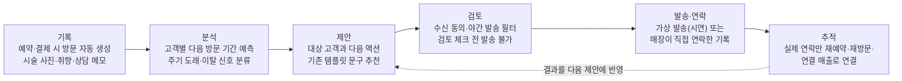
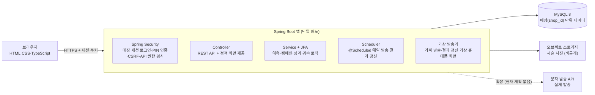

# 뷰티샵 CRM 기획서 (초본)

> 작성일: 2026-11-19 · 상태: 초본 (인터뷰·설문 수치 없이 기획 가정 기준) · 2026-11-21 E 제안 반영 (리뷰 필요, [변경 요약](./변경요약.md))

## 1. 개요

2인 이상 뷰티샵(네일·속눈썹·왁싱·반영구)의 고객 정보를 한 화면에 모으는 CRM 웹 서비스입니다. 고객별 방문 주기로 다음 방문 기간을 예측하고, 검토를 거친 메시지 발송과 성과 추적까지 잇습니다.

| 항목 | 내용 |
| --- | --- |
| 서비스명 | 미정 |
| 업무 흐름 | 기록 → 분석 → 재방문 |
| 사용자 | 직원 2명 이상 뷰티샵의 원장과 직원 |
| 형태 | 반응형 웹 (매장 PC·태블릿) |
| 문서 상태 | 초본. 인터뷰·설문 수치 없이 기획 가정 기준으로 작성 |



## 2. 기획 배경 및 문제 정의

뷰티샵의 고객 접점은 인스타그램(포트폴리오), 카카오톡(상담), 네이버(예약)로 흩어져 있습니다. 직원이 많을수록 고객 정보가 각자의 기억과 메신저에만 남고, 그 결과 매장은 다시 올 시점이 된 고객을 놓칩니다.

| 문제 | 현재 상황 | 결과 | 해결 방향 |
| --- | --- | --- | --- |
| 흩어진 고객 정보 | 예약·결제·시술 사진·상담 메모가 서로 다른 앱에 있음 | 고객 한 명의 맥락을 한 번에 보기 어려움 | 고객 상세 한 화면에 통합 |
| 직원 간 정보 단절 | 담당 직원의 기억과 개인 메신저에 의존 | 담당 변경·휴무 시 취향·주의사항 누락 | 매장 단위 공유 기록 |
| 재방문 시점 놓침 | 고객별 주기가 다른데 기준 없이 감으로 연락 | 이탈 신호를 늦게 인지 | 고객별 주기 기반 방문 기간 예측 |
| 찾기 어려운 기능 | 기존 통합 솔루션은 메뉴가 많음 | 원하는 기능까지 시간이 걸림 | 키워드 기능 검색 |
| 외국인 고객·직원 증가 | 서울 중심으로 외국인 손님·직원 증가 | 메시지·화면 이해 어려움 | 다국어 지원 (확장) |

위 내용은 기획 기준의 가정입니다. 인터뷰·설문 수치가 확보되면 이 섹션을 보강합니다.

## 3. 타깃 사용자

서비스를 쓰는 사람은 매장의 원장과 직원이고, 관리 대상은 매장의 고객입니다. 고객은 서비스에 로그인하지 않습니다.

매장 PC 한 대를 함께 쓰므로 서비스 안에서는 원장과 직원을 역할로 나누지 않고 모두 **스탭**으로 다룹니다. 로그인은 매장 계정 하나로 하고, 편의점 POS처럼 근무를 시작할 때 자기 PIN으로 "현재 근무자"를 정합니다 (교대 시 전환). 매출·고객 관리 등 민감한 기능은 원장이 기능마다 [공용 ↔ PIN] 토글로 잠글 수 있고, 잠긴 기능은 원장이 허용한 스탭이 PIN을 다시 입력해야 열립니다.

### 사용자

| 구분 | 역할 | 주요 니즈 |
| --- | --- | --- |
| 원장 | 매장 운영 책임, 메시지 발송 검토 (원장이 허용한 스탭도 가능) | 연락할 고객 파악, 매출·캠페인 성과 확인, 스탭 PIN·기능 잠금 관리 |
| 직원 | 시술 담당, 예약·결제 등록 | 방문 전 취향·사진·주의사항 확인, 시술 기록 빠르게 입력 |
| 외국인 직원 (확장) | 직원과 동일 | 관리자 화면 언어 전환 |

### 관리 대상 고객

고객을 "단골" 같은 라벨로 나누지 않습니다. 횟수만 세는 라벨은 몰아서 왔다가 끊긴 고객도 단골로 잡기 때문입니다. 대신 두 가지로 봅니다.

| 보는 것 | 내용 |
| --- | --- |
| 방문 요약 | 총 방문 횟수·총 시술 건수, 시술 카테고리별 방문 횟수·평균 간격, 시술 메뉴별 시술 횟수 |
| 예측 상태 | 시술별로 예정 / 주기 도래 / 이탈 신호 / 장기 미방문 (9장) |

```
총 방문 12회 · 시술 19건 · 첫 방문 2025-03-02 · 마지막 방문 2026-11-10
네일    방문 9회 │ 젤네일 9회, 젤 제거 3회, 아트 추가 4회 │ 평균 간격 24일
속눈썹  방문 3회 │ 연장 3회                              │ 평균 간격 45일
```

같은 시술의 방문 기록이 많을수록 예측이 정확해집니다.

### 페르소나 (가정)

- **원장 A**: 속눈썹·네일샵 운영, 직원 3명. 마감 후 예약 앱과 카카오톡을 오가며 연락할 고객을 감으로 고른다.
- **직원 B**: 2년차 네일 아티스트. 다른 직원의 단골을 대신 받을 때 이전 디자인을 인스타그램에서 찾는다.

## 4. 목표와 측정 지표

목표는 기록한 데이터가 다음 행동까지 한 흐름으로 이어지게 하는 것입니다.

1. 고객 한 명의 방문 리듬, 취향, 시술 사진, 메모를 한 화면에 모으고 직원 모두가 공유합니다.
2. 고객별 방문 주기로 다음 방문 기간을 예측하고, 지금 관리해야 할 고객을 골라줍니다.
3. 기존 작성된 문구와 다음 액션을 제안하고, 잠긴 기능이 허용된 스탭(원장 등)이 검토한 뒤에만 수신 동의 고객에게 발송합니다. 파일럿에서는 매장이 직접 연락하고 그 기록을 남깁니다 (E1).
4. 발송에서 재예약·재방문·결제까지 추적해 다음 제안에 반영합니다.

### 측정 지표

정량 목표는 파일럿 운영으로 기준치를 모은 뒤 정합니다.

| 지표 | 산식 (초안) | 측정 방법 |
| --- | --- | --- |
| 예측 정확도 | 예측 기간이 끝난 예측 중 기간 안에 실제로 방문한 비율 + 예측 중앙일과 실제 방문일의 평균 오차(일) | 예측을 만든 시점의 기간을 저장하고 다음 방문일과 비교. 기간이 아직 안 끝난 예측은 평가에서 제외 (E9) |
| 주기 내 재방문율 | 기준일에 예측이 끝난 고객 중, 이탈 신호 기간이 끝나기 전에 다시 온 고객 비율 (시술 카테고리별) | 방문 기록·예측 스냅샷 집계. 시술마다 주기가 달라도 같은 기준으로 비교 (E9) |
| 연락 대비 재예약 전환율 | 실제 연락(수동 연락) 후 N일 안에 같은 카테고리를 예약한 고객 수 ÷ 연락한 고객 수 | 연락 기록과 예약 연결 (N 기본값 14일). 가상 발송은 시연 데이터로 따로 표시하고 이 지표에 넣지 않음 (E1) |
| 자연 재방문 기준선 | 연락하지 않은 고객의 주기 내 재방문율 | 파일럿 기간 데이터. 나중에 연락·발송 효과를 비교하는 대조군 (E2) |
| 기능 탐색 시간 | 기능 검색 입력부터 대상 화면 도달까지 걸린 시간 | 검색 로그 + 파일럿 사용자 과제 테스트 |

## 5. 차별점

공비서, 핑거프로 같은 통합 관리 솔루션을 레퍼런스로 삼습니다. 다만 기능 수를 늘리기보다 "기록이 다음 행동으로 이어지는 것"에 집중합니다.

| 차별점 | 내용 | 단계 |
| --- | --- | --- |
| 기능 검색 | 메뉴 위치를 몰라도 "고객 등록", "지난달 매출"처럼 입력하면 해당 기능으로 바로 이동 | MVP |
| 재방문 기간 예측 | 고객별 평균 방문 간격과 시술별 유지 기간으로 "다음 방문까지 약 3~4주"처럼 기간으로 예측. 방문 1회 고객은 시술 평균 주기 적용 | MVP |
| 다국어 지원 | 외국인 고객용 메시지 번역, 외국인 직원용 관리자 화면 언어 전환 | 확장 |

레퍼런스 서비스의 기능·가격은 아직 조사하지 않았습니다. 직접 사용해 보고 조사한 뒤 비교표를 보강합니다.

## 6. 핵심 기능과 MVP 범위

MVP에는 "기록 → 예측 → 검토 후 발송 → 성과 추적"을 한 바퀴 돌 수 있는 최소 기능만 넣습니다. MVP의 문구 제안은 규칙과 템플릿으로 만들고, 생성형 AI는 비용과 품질을 검증한 뒤 확장 단계에서 도입합니다.

| 기능 | 하는 일 | 대표 화면 | 단계 |
| --- | --- | --- | --- |
| 고객 상세 · 시술 히스토리북 | 방문 리듬 타임라인, 취향 프로필, 시술 사진, 상담 메모, 주의사항을 고객 한 명 기준으로 모음 | 고객 상세, 시술 히스토리북 | MVP |
| 재방문 관리 (인사이트) | 예측 기간으로 주기 도래·이탈 신호·장기 미방문 고객을 나누고, 우선순위 순으로 다음 액션 제안 (규칙 기반) | 인사이트 | MVP |
| 캠페인 관리 | 시술 카테고리 하나를 정해 대상 선정 → 템플릿 개인화 → 검토 체크 → 가상 발송(시연) 또는 매장 휴대폰·카카오톡 수동 연락 후 [연락함] 기록. 수신 동의 고객만, 검토 전 발송 불가 | 캠페인 관리, 가상 휴대폰 | MVP |
| 성과 분석 | 실제 연락 기준 재예약·재방문 전환, 캠페인별·고객별 연결 기록, 연결 매출, 자연 재방문 기준선. 가상 발송 결과는 시연 탭에 분리 | 성과 분석 | MVP |
| 대시보드 · 예약 관리 | 오늘 관리할 고객(우선순위 순), 주간 예약, 완료 처리 안 된 지난 예약. 예약 완료·결제 등록 시 방문 기록 자동 생성. 다른 앱에서 잡은 다음 예약도 날짜·시술만 표시 | CRM 대시보드, 예약 관리 | MVP |
| 시술 마감 카드 | 결제 화면 한 장에서 실제 시술·금액·사진·메모·다음 예약·수신 동의까지 마감 | 예약 관리, 고객 상세 | MVP |
| 기능 검색 | 키워드로 메뉴·기능·고객을 바로 찾음 | 전체 화면 상단 검색창 | MVP |
| 매장 설정 | 시술 메뉴·기본 주기·예측 속성(주기 계산 제외, 종료 신호), 이탈 신호 기간 상한, 스탭 PIN·기능별 공용/PIN 토글 | 매장 설정 | MVP |
| 다국어 | 메시지 번역, 관리자 화면 언어 전환 | 캠페인, 전체 | 확장 |
| AI 문구 생성 | 고객 맥락을 반영한 문구 초안 생성 | 캠페인 관리 | 확장 |
| 클릭 추적 | 단축 링크로 메시지 속 링크 클릭 집계 | 성과 분석 | 확장 |
| 정액권·회원권 관리 | 선불권 판매, 잔액·횟수 차감 | 결제 | 확장 |

### 이번 범위에서 제외 (제안)

- 카드 결제(PG)·POS 연동: 결제는 금액과 수단만 기록
- 네이버 예약·인스타그램·카카오톡 연동
- 고객용 앱·예약 페이지, 네이티브 앱
- 다점포 관리, 재고·정산·급여

## 7. 주요 사용자 시나리오

아래 여섯 시나리오를 MVP 수용 테스트 기준으로 씁니다.

1. **방문 전 확인 (직원)**: 대시보드에서 오늘 예약을 연다 → 고객 상세 상단의 주의사항·취향을 확인한다 → 지난 시술 사진을 보며 시술을 제안한다.
2. **시술 후 기록 (직원)**: 예약에서 [시술 마감]을 누른다 → 한 화면에서 실제 시술·금액을 확인하고 사진·메모를 붙인다 → 다음 예약(다른 앱에서 잡았으면 날짜만)과 수신 동의를 함께 받는다 → 방문 기록이 생기고 다음 방문 예측이 갱신된다.
3. **재방문 관리 (원장)**: 대시보드의 "오늘 관리할 고객"에서 우선순위가 높은 주기 도래·이탈 신호 고객을 확인한다 → 고객별 추천 액션을 본다 → 시술 카테고리를 정해 대상을 골라 캠페인을 만든다.
4. **캠페인 발송·연락 (원장)**: 미동의·수신 거부 고객이 자동 제외된다 → 템플릿을 고르고 고객별 미리보기를 확인한다 → 검토 체크 후 가상 발송하거나, 매장 휴대폰·카카오톡으로 직접 보내고 [연락함]을 누른다. 야간(21~08시)에는 야간 광고 동의 고객만 대상일 때만 보낼 수 있고, 그 밖에는 예약 발송으로 유도한다.
5. **성과 확인 (원장)**: 성과 분석에서 실제 연락→재예약→재방문 전환과 연결 매출을 자연 재방문 기준선과 비교해 본다 → 기준선보다 성과가 좋은 템플릿을 다음 캠페인에 쓴다.
6. **기능 검색 (전체)**: 상단 검색창에 "지난달 매출"을 입력한다 → PIN을 입력한다 → 기간이 지난달로 설정된 성과 분석 화면으로 이동한다.

## 8. 화면 구성

좌측 메뉴 7개와 전체 화면 상단의 기능 검색창으로 구성합니다. 메뉴를 깊게 중첩하지 않고, 각 메뉴는 한두 화면으로 끝냅니다. 접근의 "공용"은 매장 계정 로그인과 근무자 PIN만으로, "PIN"은 잠긴 기능 사용이 허용된 스탭이 PIN을 다시 입력한 뒤 쓸 수 있다는 뜻입니다. 표의 접근은 기본값이며, 원장이 기능별 토글로 바꿀 수 있습니다 (설정은 항상 원장 PIN).

| 메뉴 | 화면 | 주요 요소 | 접근 |
| --- | --- | --- | --- |
| 대시보드 | CRM 대시보드 | 오늘 예약, 오늘 관리할 고객, 이번 주 예약 요약 | 공용 |
| 예약 | 예약 관리 | 스탭별 주간 캘린더, 예약 등록·완료·결제 | 공용 (결제 수정·취소는 PIN) |
| 고객 | 고객 목록 / 고객 상세 / 시술 히스토리북 | 검색·방문 횟수·시술·상태 필터, 방문 요약, 타임라인, 취향, 사진, 메모, 동의 | 공용 (연락처 전체·정보 수정은 PIN) |
| 인사이트 | 재방문 관리 | 주기 도래 / 이탈 신호 / 장기 미방문 탭(우선순위 순), 추천 액션, 연락함 기록 | 공용 |
| 캠페인 | 캠페인 목록 / 캠페인 작성 / 템플릿 / 가상 휴대폰 | 대상 선정, 제외 사유, 미리보기, 검토 체크, 발송 | PIN |
| 성과 | 성과 분석 | 캠페인 전환 퍼널, 연결 매출, 매출·재방문율 | PIN |
| 설정 | 매장 설정 | 매장 정보, 시술 메뉴·주기, 고객 상태 기준, 스탭·PIN·기능 잠금, 발송 설정 | 원장 PIN |

## 9. 재방문 기간 예측 로직 (MVP)

MVP는 머신러닝 없이 방문 간격 통계와 시술별 기본 주기만으로 기간을 계산합니다. 이 방식은 설명하기 쉽고, 데이터가 적어도 동작하며, 추가 서버 비용이 들지 않습니다.

### 계산 규칙

예측은 고객 × 시술 카테고리별로 따로 계산합니다. 네일과 왁싱을 모두 받는 고객은 예측을 두 개 가지며, 각 예측은 해당 시술이 포함된 방문만 사용합니다.

| 방문 수 | 기준 간격 | 예측 범위 | 화면 표시 예 |
| --- | --- | --- | --- |
| 3회 이상 | 최근 5개 간격의 평균 | 평균 ± 표준편차 (최소 ±3일) | "약 3~4주 후 (평균 24일, 방문 6회)" |
| 2회 | 실제 간격 1개와 마지막 시술 기본 주기 중간값의 평균 | 시술 기본 주기의 범위 폭 | "약 3~5주 후 (시술 평균 주기 기준)" |
| 1회 | 마지막 시술의 기본 주기 | 기본 주기 범위 그대로 | "약 3~4주 후 (시술 평균 주기 기준)" |

- 예측 시작일·종료일 = 마지막 방문일 + 범위. 화면에는 주 단위로 반올림해 보여주고 날짜도 함께 표시합니다.
- 시술별 기본 주기는 매장 설정에서 수정합니다. 초기값은 네일 21~28일, 속눈썹 30~60일, 왁싱 28~42일, 반영구 365~730일, 기타 28~56일입니다. 속눈썹은 사람마다 주기 차이가 커서 넓게 잡고, 기록이 3회 이상 쌓이면 고객 본인 주기로 예측합니다.
- 시술 메뉴마다 예측 속성을 둡니다 (E5).
  - **주기 계산 제외**: 반영구 첫 리터치, 아트 추가 같은 애드온처럼 "다시 올 주기"를 뜻하지 않는 시술. 이 시술만 받은 방문은 간격 계산에 쓰지 않습니다. 반영구 리터치(4~6주)가 1~2년 주기를 끌어내리는 것을 막습니다.
  - **종료 신호**: "젤 제거만"처럼 그만두는 손님이 받는 시술. 이 시술만 받은 방문 뒤에는 예측을 새로 시작하지 않고 바로 이탈 신호로 봅니다.
- 기본 주기는 시술 카테고리 기본값과 메뉴별 값을 둡니다. 메뉴가 없는 가져온 방문은 카테고리 기본값을, 한 방문에 같은 카테고리 메뉴가 여럿이면 주기 계산 제외가 아닌 메뉴 중 가장 긴 주기를 씁니다.
- 방문 기록이 생기거나 수정·삭제될 때 해당 고객만 다시 계산합니다. 상태는 조회할 때 오늘 날짜와 비교해 정하므로 야간 배치가 필요 없습니다.

### 상태 분류

다음 예약에 해당 시술이 있으면 그 시술의 관리 대상에서 빠집니다. 시술을 정하지 않은 예약이면 고객 전체가 빠집니다. "다음 예약"은 오늘 이후의 확정 예약이며, 네이버 등 다른 앱에서 잡아 날짜·시술만 표시한 외부 예약도 포함합니다 (E3).

| 상태 | 조건 (오늘 기준) | 기본 액션 |
| --- | --- | --- |
| 예정 | 오늘 < 예측 시작일 | 없음 |
| 주기 도래 | 예측 시작일 ≤ 오늘 ≤ 예측 종료일 | 재방문 안내 템플릿 추천 |
| 이탈 신호 | 예측 종료일 < 오늘 ≤ 종료일 + 이탈 신호 기간 | 안부·혜택 템플릿 추천 |
| 장기 미방문 | 그 이후 | 재방문 혜택 템플릿 추천, 또는 [관리 종료] (목록에서 숨기고 다음 방문 때 자동 복귀) |

이탈 신호 기간은 그 고객의 해당 시술 평균 간격입니다 (방문 3회 이상). 기록이 부족하면 시술 기본 주기 최대값을 쓰고, 상한은 기본 120일이며 매장 설정에서 바꿀 수 있습니다. 평균 45일마다 오는 고객은 예측이 끝나고 45일 동안 이탈 신호, 그 뒤 장기 미방문이 됩니다.

수신 동의가 없는 고객에게는 발송 대신 "다음 방문 시 수신 동의 요청"을 다음 액션으로 제안합니다. 동의는 시술 마감 카드에서 공용으로 받습니다 (E8).

### 오늘 관리할 고객 우선순위 (E6)

목록과 대시보드 상위 10명은 아래 순서로 정렬합니다. 머신러닝 없이 원장에게 "왜 이 고객이 먼저인지" 설명할 수 있는 규칙입니다.

1. **경과 비율** 높은 순: (오늘 − 예측 종료일) ÷ 이탈 신호 기간. 주기 도래는 0 이하, 이탈 신호는 0~1. 이탈 신호가 끝나기 직전 고객이 맨 위로 옵니다.
2. 수신 동의 고객 먼저 (바로 연락할 수 있음)
3. 최근 6개월 결제 합계 높은 순

반영구처럼 주기 도래 기간이 긴 시술도 경과 비율로 다른 시술과 같은 기준에서 비교됩니다.

## 10. 개인정보·법규 고려 사항

법규 준수는 운영 안내가 아니라 시스템 제약으로 구현합니다. 사용자가 실수해도 위반 발송이 나가지 않게 하는 것이 기준입니다. 출시 전 법무 검토가 필요합니다.

| 항목 | 요구 | 시스템 반영 |
| --- | --- | --- |
| 광고성 정보 수신 동의 | 수신 동의 고객에게만 발송 | 동의 여부·일시 저장, 미동의·철회 고객은 대상에서 자동 제외 |
| 광고 표기 | 앞에 "(광고)"·전송자 명칭·연락처, 끝에 무료 수신 거부 방법 | 템플릿에 자동 삽입, 사용자가 삭제·변형 불가. 수신 거부 처리 결과 안내 |
| 야간 발송 제한 | 21~08시 광고 발송은 별도 동의 필요 | 해당 시간 즉시 발송 차단, 예약 발송으로 유도 (서울 시간 기준) |
| 수신 동의 재확인 | 동의일부터 2년마다 동의 여부 확인 | 동의일 기준 재확인 대상 고객 목록 제공 |
| 개인정보 수집·이용 동의 | 목적·항목·보관 기간 고지 | 필수(연락처·방문 기록)와 선택(시술 사진·마케팅·야간 광고·건강 정보) 동의를 분리해 기록 |
| 민감정보 | 건강 정보(알레르기·피부 질환 등)는 별도 동의 필요 | 건강 정보 동의 고객만 주의사항에 건강 관련 내용 입력, 철회 시 즉시 삭제 |
| 시술 사진 | 별도 동의, 철회·거래 종료 시 삭제 | 사진 동의 고객만 업로드, 철회 시 즉시 삭제, 비공개 저장 |
| 보관 기간·파기 | 고지한 보유 기간이 끝나면 지체 없이 파기 (법정 고정 기간 없음) | 마지막 방문 후 3년(매장 설정 1~5년) 지난 고객을 파기 대상으로 표시, 원장 확인 후 삭제 |
| 접근 권한·기록 | 필요한 사람만 민감 정보 열람, 누가 접근했는지 기록 | 근무자 전환으로 모든 기록에 사람을 남김, 공용 화면은 연락처 마스킹, 연락처 전체·매출·캠페인은 기본적으로 PIN 재입력 후 열람, 접근 로그 2년 보관 |
| 처리 위탁 | 서버·사진 저장소 등 수탁사 고지 | 매장이 고객에게 고지할 수 있는 동의서·위탁 문구 예시 제공 |

고객 정보의 수집 주체는 매장(위탁자)이고, 서비스 운영자는 처리 수탁자입니다 (개인정보보호법 제26조). 이용약관에 처리위탁 조항과 재수탁사(서버·사진 저장소) 목록을 넣어 가입 시 동의받습니다.

## 11. 기술 스택과 시스템 구성

MVP는 Spring Boot 앱 하나가 화면(정적 HTML·TS)과 REST API를 함께 제공하고 MySQL 하나에 저장하는 구조입니다. 서버 한 대로 운영할 수 있어 운영 비용이 가장 낮습니다.



브라우저는 앱과만 통신하고, DB·사진 저장소·문자 API는 앱을 통해서만 접근합니다. API 키는 서버 환경 변수에만 둡니다.

| 영역 | 선택 (제안) | 이유 |
| --- | --- | --- |
| Frontend | HTML·CSS + TypeScript, 프레임워크 없이 tsc로 컴파일 | 지정 스택, 화면 수가 적어 빌드 도구 최소화 |
| Backend | Java 21 · Spring Boot 3 (Spring MVC, Servlet) | 지정 스택 |
| 인증·권한 | Spring Security 매장 계정 세션 로그인 + 근무자 PIN + 잠긴 기능 PIN 재인증, CSRF 보호, API 단위 권한 검사 | 같은 도메인에서 화면을 제공하므로 토큰 방식 불필요 |
| 데이터 | MySQL 8 + Spring Data JPA | 지정 스택, 모든 업무 테이블에 shop_id로 매장 격리 |
| 예약 발송 | Spring @Scheduled | 매장 단위 발송량이면 별도 큐 불필요 |
| 사진 | S3 호환 오브젝트 스토리지, 비공개 + 서명 URL | 서버 디스크는 백업·교체에 불리 (제공사 미결) |
| 문자 발송 | 서비스 내부 가상 발송기 + 가상 휴대폰 화면. 파일럿을 포함해 실제 발송은 하지 않음 | 비용 0. 실제로 전송되지 않으므로 개발·시연용 |

## 12. 단계별 로드맵

각 단계는 앞 단계의 검증이 끝난 뒤 시작합니다. 일정은 개발 인원이 정해지면 채웁니다.

1. **문제 검증**: 원장·직원 인터뷰로 배경 가정(정보 단절, 재방문 놓침)과 시술별 기본 주기를 확인합니다. 통과 기준: 파일럿 참여 매장 확보.
2. **MVP 1차 — 기록과 예측**: 매장 계정·스탭 PIN·기능별 잠금, 고객 상세·히스토리북, 예약·결제·방문 자동 생성, 재방문 예측·인사이트, 대시보드, 기능 검색, 매장 설정.
3. **MVP 2차 — 발송과 성과**: 템플릿·캠페인·검토 체크·가상 문자 발송과 가상 휴대폰 화면, 수신 동의·야간 제한, 성과 분석·연결 매출.
4. **파일럿**: 소수 매장에서 운영하며 측정 지표의 기준치를 모으고 정량 목표를 정합니다. 자동 발송은 가상 발송으로만 처리하고, 실제 연락은 매장이 직접 하고 [연락함]으로 기록합니다. 연락하지 않은 고객의 재방문 데이터는 자연 재방문 기준선(대조군)으로 씁니다 (E2).
5. **확장**: 다국어, AI 문구 생성, 클릭 추적, 카카오 메시지 채널, 외부 예약 연동 중 파일럿에서 요청이 많은 순서로 진행합니다.

## 13. 리스크와 미결 사항

가장 큰 리스크는 "매장이 기록을 꼬박꼬박 하지 않아 예측이 틀리는 것"입니다.

| 리스크 | 영향 | 대응 |
| --- | --- | --- |
| 이중 입력 부담 (네이버 예약 등 기존 도구 병행) | 방문 누락 → 예측 부정확 | 시술 마감 카드 한 장으로 방문·사진·다음 예약·동의를 끝내기, 완료 처리 안 된 지난 예약을 대시보드에 표시 (E4) |
| 다른 앱으로 이미 예약한 고객에게 재방문 안내 | 불필요한 연락, 고객 불쾌 | 다음 예약을 날짜·시술만 외부 예약으로 표시해 관리 대상에서 제외 (E3) |
| 파일럿에서 실제 발송이 없어 성과가 측정되지 않음 | "추적 → 다음 제안" 흐름이 시연에 그침 | 수동 연락 기록만 성과에 연결, 가상 발송은 시연으로 분리 (E1) |
| 초기 방문 데이터 부족 | 도입 초기 예측 신뢰 낮음 | 시술 기본 주기로 대체, "시술 평균 주기 기준" 라벨 표시 |
| 문자 발송 비용·오발송 | 비용 초과, 법규 위반 | 가상 발송이라 비용 0원·실제 전송 없음. 검토 체크, 발송 전 건수·예상 비용 표시, 매장별 일 발송 한도는 그대로 둠 |
| 개인정보 유출 | 신뢰·법적 책임 | 매장 단위 데이터 격리, 기능별 PIN 잠금, 연락처 마스킹, 사진 비공개 저장, 접근 로그 |
| 기능 검색이 원하는 결과를 못 찾음 | 차별점 약화 | 매칭되지 않은 검색어 로그로 키워드 사전 보강 |

### 미결 사항

- [ ] 서비스명
- [ ] 과금 모델 (매장당 월 구독 등)
- [ ] 시술 사진 저장소
- [ ] 네이버 예약 등 외부 예약 연동 가능성
- [ ] 법 조문 최종 확인 (안전성 확보조치 기준 제5조, 정보통신망법 시행령 별표 6 현행본)
