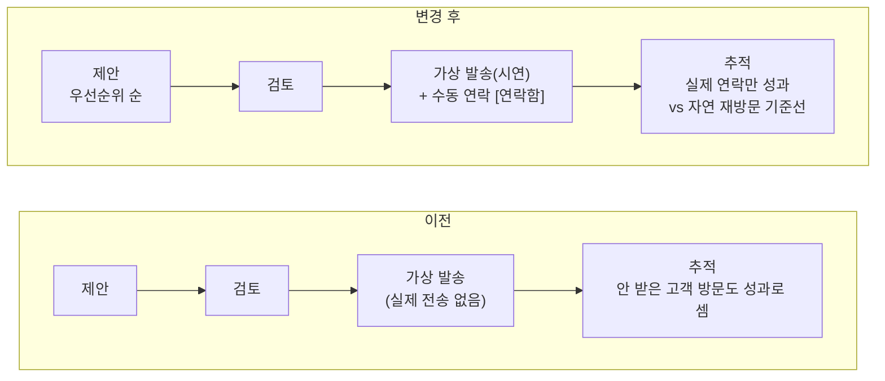

# 변경 요약 (docs/modify-ysb)

> 작성일: 2026-11-21 · 작성: ysb · 상태: **리뷰 필요** · 자세한 근거: [결정체크리스트 E 묶음](./결정체크리스트.md#e-인사이트-기반-개선-제안-2026-11-21-ysb)

## 한 줄 요약

**큰 흐름(기록 → 분석 → 제안 → 검토 → 발송 → 추적)은 그대로 두고, A~D 결정끼리 맞물리며 흐름이 끊기던 9곳을 기능으로 메웠습니다.** 기술적 허점보다 "매장이 실제로 쓰면 어디서 막히는가"를 기준으로 봤습니다.

## 가장 중요한 3가지

1. **파일럿에서 성과가 가짜 숫자가 되는 문제 → 실제 연락 기록으로 해결 (E1·E2)**
   가상 발송만 쓰면 메시지를 받지 않은 고객의 방문도 "캠페인 덕분"으로 집계됩니다. 매장이 직접 연락하고 [연락함]만 누르면 그 기록으로 성과를 재고, 연락 안 한 고객은 대조군이 됩니다.
2. **네이버로 이미 예약한 고객에게 "다시 오세요"가 가는 문제 → 외부 예약 표시 (E3)**
   우리 시스템 예약만 보던 A11 규칙이, 다음 예약 날짜 한 칸 입력으로 실제로 작동합니다.
3. **기록 누락 = 예측 실패 → 시술 마감 카드 한 장 (E4)**
   손님이 카운터에 있는 1~2분 안에 결제·사진·메모·다음 예약·동의를 한 화면에서 끝냅니다.

## 흐름 비교

## 변경 9가지 한눈에 보기

| # | 문제 (이전) | 바꾼 것 | 기대 효과 | 반영 위치 |
| --- | --- | --- | --- | --- |
| E1 | 가상 발송인데 14일 안 방문을 성과로 셈 → 파일럿 성과 전부 가짜. 가상 휴대폰 수신거부가 실제 동의를 철회 | 수동 연락 채널([연락함]) 추가, 성과는 실제 연락만. 가상 발송은 "시연" 탭 분리 | 비용 0원 유지하면서 진짜 성과 데이터 확보 | FR-CMP-11·18, FR-PRD-07, FR-ANL-01·03, FR-VIS-04 |
| E2 | 기획서 4장 "시연으로만 확인" vs 로드맵 "파일럿에서 기준치 수집" 충돌 | 연락 안 한 고객의 재방문율을 자연 재방문 기준선으로 표시 | 나중에 실제 발송을 켤 때 "메시지 효과"를 증명할 근거 | FR-ANL-09, 기획서 4·12장 |
| E3 | 네이버 예약 고객이 "주기 도래"로 떠서 불필요한 연락 | 외부 예약(날짜·시술만) 기록, "다음 예약"에 포함 | 연동 없이 A11 규칙이 실제로 작동 | FR-RSV-06, FR-PRD-04 |
| E4 | 결제·사진·메모·동의가 흩어져 기록 누락 → 예측 실패 | 시술 마감 카드 한 장 + 마감 안 된 예약 목록 | 가장 큰 리스크(기록 누락) 직접 대응 | FR-PAY-04, FR-DSH-05 |
| E5 | 반영구 리터치가 주기를 왜곡, "젤 제거만" 고객은 예측이 새로 시작 | 메뉴 예측 속성: 주기 계산 제외 / 종료 신호. 카테고리 기본 주기 분리 | 원장의 시술 지식을 설정 한 칸으로 예측에 반영 | FR-PRD-01, FR-SET-02 |
| E6 | "상위 10명" 정렬 기준 없음, "관리 종료"가 요구사항에 없음 | 경과 비율 → 동의 여부 → 최근 매출 순. [관리 종료] 추가 | "누구부터 연락하지?"에 바로 답함 | FR-PRD-09·10, FR-DSH-02 |
| E7 | 인사이트는 고객×카테고리, 캠페인은 고객 단위 → 문구·성과 기준 모호 | 캠페인마다 시술 카테고리 하나, 같은 카테고리만 귀속 | 캠페인 목적·문구·성과가 한 줄로 정리 | FR-CMP-01·03, FR-ANL-03 |
| E8 | 카운터에서 동의 받을 때마다 PIN 필요, 철회도 PIN | 받기·철회는 공용, 정정만 PIN. 동의 방법(태블릿·서면·구두) 기록 | 캠페인 대상이 늘어나는 순간이 막히지 않음 | 2장, FR-CUS-09 |
| E9 | 재방문율이 시술 주기를 무시, 정확도는 범위를 넓히면 오름, CSV 올리면 신규 고객 폭증 | 주기 내 재방문율, 예측 평균 오차(일), 신규 = 첫 방문일 기준 | 원장이 믿을 수 있는 숫자, A7 공식 조정 근거 | FR-ANL-05·07, 기획서 4장 |

## 함께 정리한 작은 불일치

| 위치 | 이전 | 변경 |
| --- | --- | --- |
| FR-CMP-09, 기획서 시나리오 4 | 즉시 발송은 야간 동의 고객이면 허용인데, 예약 발송은 야간 시각 선택 불가 | 둘 다 "야간 광고 동의 고객만 대상이면 허용"으로 통일 |
| FR-DSH-04 | 고정 공용인 대시보드에서 PIN 기능인 캠페인 성과가 보임 | 캠페인 결과 조회가 PIN이면 PIN 인증 중에만 표시 |
| 기획서 6·8장 | 인사이트 화면명 "고객 관리"가 명세서 3.2 "고객 관리"와 겹침 | 화면명을 "재방문 관리"로 변경 |

## 리뷰 방법

- 항목별로 PR 코멘트에 **승인 / 수정 / 제외**를 남겨 주세요. 승인되면 결정체크리스트 결정 현황 표의 "제안 반영 (리뷰 필요)"를 확정 문구로 바꿉니다.
- 제외된 항목은 이 표의 "반영 위치"를 기준으로 되돌립니다.
- 우선순위가 바뀐 것: FR-PRD-07 연락함 표시 **P2 → P1** (E1에서 성과 귀속의 기준이 되었기 때문).

## 이번 범위에서 다루지 않은 것 (기술 항목, 별도 검토 권장)

이번 변경은 기능·인사이트 관점만 다뤘습니다. 아래는 리뷰 중 발견했지만 이번에 손대지 않은 기술적 항목입니다.

- 원장 PIN 재설정(FR-ACC-09)이 스탭이 공유하는 매장 비밀번호로 가능함 → 가입 이메일 인증 검토
- PIN 실패 잠금이 매장 단위라 한 명의 실수로 근무자 전환까지 매장 전체가 5분 정지
- 이름 선택 없이 PIN만으로 근무자를 식별(PIN 중복 불가 규칙의 원인). 원장이 모든 PIN을 알아 "누가" 기록의 신뢰도가 낮음
- 고정 공용 화면(대시보드·기능 검색·고객 상세의 결제 이력)이 원장의 PIN 토글을 일부 우회
- 5장 일부 엔티티에 shop_id 없음, access_log에 현재 근무자와 PIN 인증 스탭을 함께 남길 칸 필요, C12 삭제 표에 예측 테이블 처리 없음
- `.claude/agents/doc-editor.md` 용어표의 "실제 발송 방식은 파일럿 전 결정"이 A6 확정 내용과 다름 (규칙상 이 파일은 수정하지 않음). 또 이 에이전트는 E 같은 새 제안을 다루지 않으므로, E가 승인되면 기준 목록에 E를 추가해야 함
